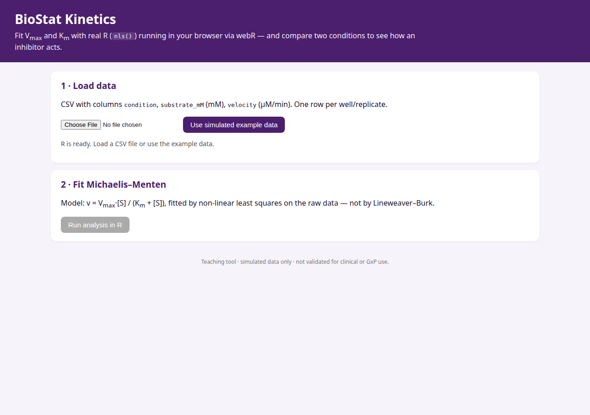
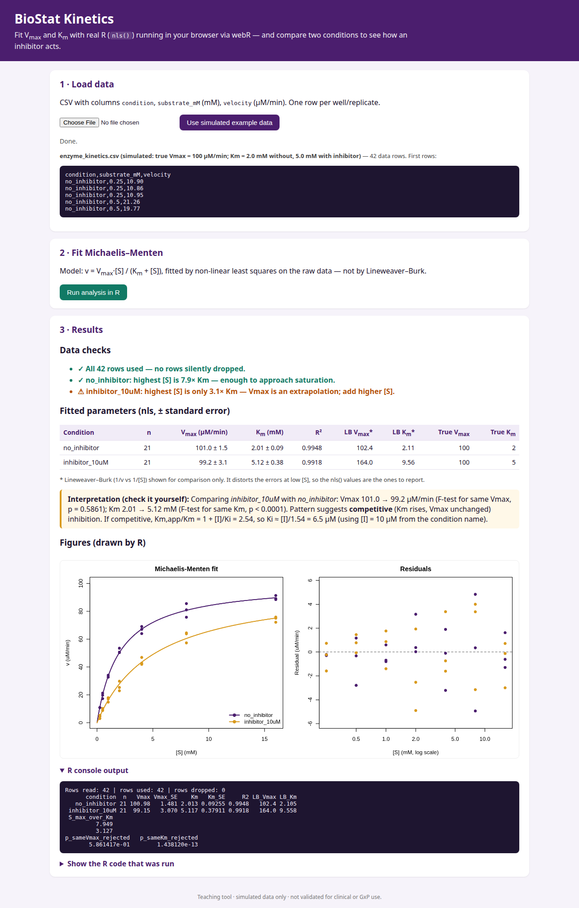
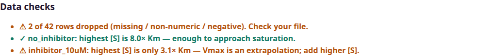

# BioStat Kinetics — a Michaelis–Menten analyser that runs R in the browser

**Homework for:** From Pipette to Prompt — Agentic AI workshop, Year 3 Biochemistry, CUHK
**Example chosen:** Example 1 — Enzyme kinetics (upload kinetics data; fit Vmax and Km)

## The app idea

BioStat Kinetics is a one-page web app (Vite + JavaScript) that runs **real R** in the browser through **webR** (R compiled to WebAssembly). You upload a CSV from a kinetics experiment and the app:

1. **Checks the data first.** It reports how many rows were read and how many were used, so missing or non-numeric rows are never dropped silently.
2. **Fits the Michaelis–Menten equation** $v = V_{max}[S]/(K_m + [S])$ to each condition with `nls()` on the raw data, and reports $V_{max}$ and $K_m$ ± standard error and $R^2$.
3. **Shows the Lineweaver–Burk estimate next to it, for comparison only**, so you can see how the double-reciprocal plot distorts the errors.
4. **Compares two conditions** (for example without and with an inhibitor) using extra-sum-of-squares F-tests: shared-$V_{max}$ vs separate model, and shared-$K_m$ vs separate model. From the pattern it suggests an inhibition type and, for competitive inhibition, estimates $K_i$ from $K_{m,app}/K_m = 1 + [I]/K_i$.
5. **Draws honest figures in R.** Raw replicate points with the fitted curves (no linearisation), plus a residual plot.
6. **Warns about weak designs.** It flags a condition when the highest [S] is less than 5 × $K_m$, because then $V_{max}$ is an extrapolation.
7. **Shows the full R code and console output** under the results, so every number can be traced.

**Input format** (one row per well or replicate):

| column | meaning | unit |
|---|---|---|
| `condition` | e.g. `no_inhibitor`, `inhibitor_10uM` | text |
| `substrate_mM` | substrate concentration | mM |
| `velocity` | initial rate | µM/min |

## Link to biochemistry research

Screening enzyme inhibitors is a core step in drug discovery. Medicinal chemists need to know both how strongly a compound inhibits a target ($K_i$) and how it inhibits it (competitive, non-competitive, mixed). That tells them whether the compound competes with the substrate at the active site, and whether high substrate levels in the cell could overcome it. Labs often still fit kinetics by Lineweaver–Burk in a spreadsheet. That method weights the noisy low-[S] points most heavily, so it can give badly biased parameters. This app does the statistically correct thing (non-linear least squares on the raw velocities) and runs a formal test for which parameter the inhibitor changes. It also checks the experimental design (rows dropped, [S] range relative to $K_m$), so that the result is checked as well as calculated.

## Validation with known answers

The example dataset `data/enzyme_kinetics.csv` is **simulated** with known true values: $V_{max}$ = 100 µM/min for both conditions, $K_m$ = 2.0 mM without inhibitor, and $K_m$ = 5.0 mM with 10 µM of a competitive inhibitor. That gives a true $K_i$ of about 6.7 µM. Each condition has 7 [S] levels × 3 replicates, with about 4% noise.

| | True | nls() fit (app) | Lineweaver–Burk |
|---|---|---|---|
| Vmax, no inhibitor | 100 | 101.0 ± 1.5 | 102.4 |
| Km, no inhibitor | 2.0 | 2.01 ± 0.09 | 2.11 |
| Vmax, inhibitor | 100 | 99.2 ± 3.1 | **164.0** |
| Km, inhibitor | 5.0 | 5.12 ± 0.38 | **9.56** |
| Ki | 6.7 µM | 6.5 µM | — |

F-test for same Vmax: p = 0.59 (not rejected). F-test for same Km: p < 0.0001 (rejected). The app therefore suggests **competitive inhibition**, which is correct.

## Screenshots

**Start screen** (webR has loaded R in the browser and is waiting for data):



**Results** (data checks, fitted parameters vs true values, interpretation, and figures drawn by R):



**Extra test: a file with a missing value and a non-numeric value** (the app reports that 2 rows were dropped instead of hiding it):



## How to run it

In a GitHub Codespace (or any machine with Node.js 18 or later):

```bash
npm install
npm run dev
```

Then open the `localhost:5173` link ("Open in Browser"). Wait for "R is ready", then click **Use simulated example data** → **Run analysis in R**, or upload your own CSV. webR is loaded from `webr.r-wasm.org`, so you need an internet connection the first time.

## Project files

```
index.html                 page layout
src/main.js                loads webR, sends the CSV to R, shows results
src/analysis.R             all the statistics (nls, F-tests, plots) — readable on its own
src/style.css              styling
data/enzyme_kinetics.csv   simulated dataset with known true parameters
data/test_with_missing_values.csv   test file with 2 bad rows
public/enzyme_kinetics.csv copy served to the "example data" button
screenshots/               images used in this README
PROMPTS.md  EVALUATION.md  REFLECTION.md
```

## Limits and responsible use

This is a teaching tool, used only with simulated data. It is not validated for clinical or GxP use. It assumes initial-rate data and simple Michaelis–Menten behaviour (no cooperativity and no substrate inhibition). The inhibition-type label is a suggestion based on two F-tests, so check it against the plot and your biochemical knowledge.

**AI-use declaration:** the app, its code and the first drafts of these documents were produced with an AI agent (Perplexity Computer) rather than GitHub Copilot. PROMPTS.md lists the build and correction prompts. The results were checked against the known simulated values.
